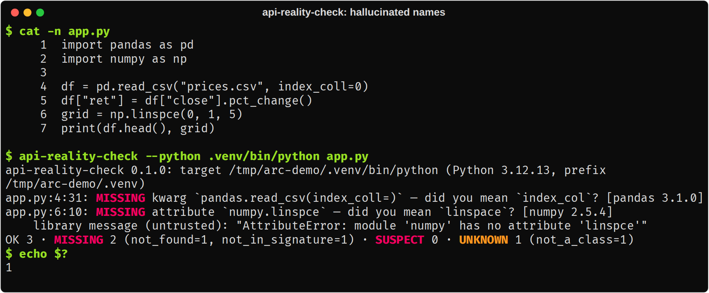
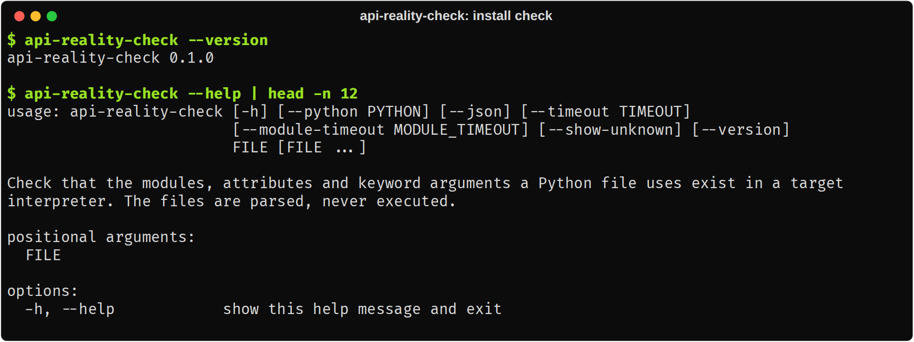
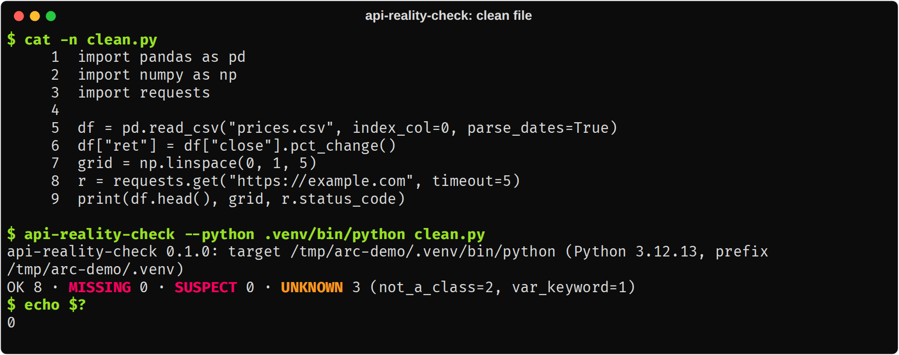
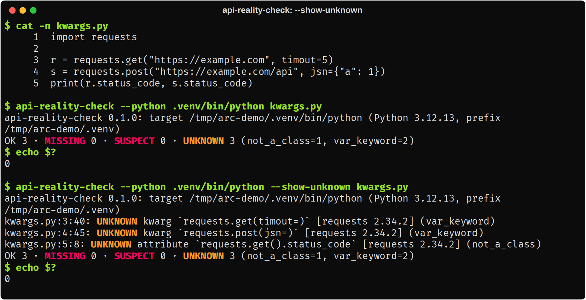
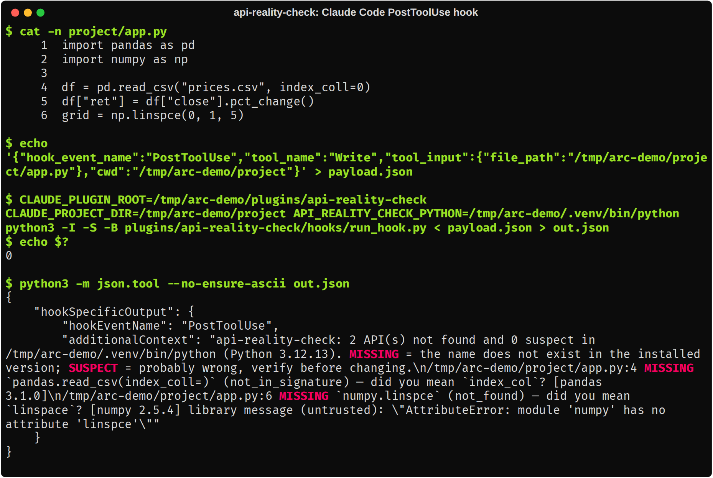

# api-reality-check

Checks that the imports, attributes and keyword arguments in AI-written Python exist in your installed library versions.

Version 0.1. The tool needs Python 3.10 or later. It has no runtime dependencies.



*The tool finds `index_coll=` and `np.linspce`, and suggests `index_col` and `linspace`.*

## What it does

AI tools often write calls to APIs that do not exist. The names can be misspelled, invented, removed in your version, or in the wrong module. This tool reads a Python file and finds each module, attribute chain and keyword argument that the file uses. It then asks the target interpreter if each one exists. The target interpreter is the Python of the virtual environment where the libraries are installed.

The tool parses your file with `ast`. It never runs your code. To get its answers, it imports the libraries that your file uses, in a separate process.

Example. The file `example.py` has two errors:

```python
import numpy as np
import requests

x = np.linspce(0, 1, 5)
r = requests.get("https://example.com", timout=5)
```

Run the tool:

```
$ api-reality-check example.py --python .venv/bin/python
api-reality-check 0.1.0: target /home/me/project/.venv/bin/python (Python 3.12.13, prefix /home/me/project/.venv)
example.py:4:7: MISSING attribute `numpy.linspce` — did you mean `linspace`? [numpy 2.5.4]
    library message (untrusted): "AttributeError: module 'numpy' has no attribute 'linspce'"
OK 3 · MISSING 1 (not_found=1) · SUSPECT 0 · UNKNOWN 1 (var_keyword=1)
$ echo $?
1
```

The tool reports `np.linspce` as MISSING. It does not report `timout=5`, because `requests.get` accepts `**kwargs`. Its signature cannot prove that `timout` is wrong, so the verdict is UNKNOWN. Add `--show-unknown` to see this line:

```
example.py:5:40: UNKNOWN kwarg `requests.get(timout=)` [requests 2.34.2] (var_keyword)
```

## How to use

These images come from real runs of the tool. `scripts/screenshots.py` makes them again (see `scripts/README.md`).

1. Install the tool and check the version.

   

   *`--version` and `--help` show that the install worked.*

2. Run it on a file, with `--python` set to the interpreter of the venv that has your libraries.

   

   *Each MISSING finding has the file, line, name and a closest-match suggestion. The exit code is 1.*

3. A correct file gives no MISSING findings.

   

   *The exit code is 0. UNKNOWN items do not change the exit code.*

4. Use `--show-unknown` to see the items that the tool cannot prove.

   

   *`requests.get` accepts `**kwargs`, so the tool cannot prove that `timout=` is wrong. It reports UNKNOWN, not MISSING.*

5. Use the Claude Code hook to check each `.py` file that Claude writes or edits.

   

   *The hook sends the findings to Claude as `additionalContext`. The exit code is always 0.*

## How it differs from package-name checkers

Some tools, for example DeepSec, check only that a package name exists. This tool goes further. It checks the module path, each attribute in a chain such as `np.linalg.norm`, and each keyword argument at a call. It checks them against the versions that you installed, not against documentation or type stubs.

## Install

Install from git:

```
pip install git+https://github.com/rajib2k5/api-reality-check
```

Or install from a local clone:

```
pip install -e .
```

Install the tool in any Python 3.10 or later. The libraries that you want to check do not need to be in the same environment. Use `--python` to point to them.

## CLI usage

```
api-reality-check [-h] [--python PYTHON] [--json] [--timeout TIMEOUT]
                  [--module-timeout MODULE_TIMEOUT] [--show-unknown]
                  [--version]
                  FILE [FILE ...]
```

| Flag | Meaning |
|---|---|
| `--python PYTHON` | Target interpreter. The default is `$VIRTUAL_ENV/bin/python`, then the Python that runs the tool. A relative path is allowed. |
| `--json` | Machine-readable output. It includes UNKNOWN findings. |
| `--timeout TIMEOUT` | Time limit for the whole run, in seconds: reading, parsing, planning and the probe. The default is 30. It must be more than 0. |
| `--module-timeout MODULE_TIMEOUT` | Import time limit for each module, in seconds. The default is 10. It must be more than 0. |
| `--show-unknown` | Also print UNKNOWN findings. |
| `--version` | Show the version. |

The first output line names the target interpreter and its prefix. Read it to make sure that the tool checks the correct environment.

The last line counts the findings for each verdict. The reason codes in parentheses belong to the verdict before them. In `--json` output, `summary.by_reason` has one dictionary for each verdict.

Use the `api-reality-check` command, or `python -I -m api_reality_check`. Do not use `python -m api_reality_check` in a directory that you do not trust. Without `-I`, Python imports modules from the current directory first, and a file such as `json.py` there would run.

Exit codes:

| Code | Meaning |
|---|---|
| 0 | No MISSING finding. |
| 1 | At least one MISSING finding. |
| 2 | Usage error, internal error, unusable interpreter, or a file that the tool could not analyze. |

SUSPECT findings never change the exit code.

## The three verdicts

The tool puts precision first. A false MISSING on correct code is the worst result. It makes people lose trust in the tool. In the hook, it makes Claude change code that works. When the tool cannot be sure, it says UNKNOWN.

**MISSING.** The tool has proof that the reference does not exist. Examples:

- The module is not installed, and it is not a local module.
- The attribute raises `AttributeError` after the tool imports the parent module and its submodule.
- The keyword is not in the signature of a pure-Python function that has no `**kwargs`.

**SUSPECT.** The evidence points to a mistake, but it is not proof. Examples:

- A keyword argument to a C function. The text signature of a C function can be wrong. For example, `np.arange(start=1, stop=5)` works, although its text signature does not allow it.
- A new attribute on an instance of a class that has `__dict__` or `__getattr__`. For example, `df.rolling_mean(3)` on a `pandas.DataFrame`.
- A wrong keyword in a method call on such an instance, for example `df.sort_values("x", descending=True)`. The reason is `instance_may_shadow`: the instance can replace the method with a different function.

SUSPECT is a warning. It does not change the exit code.

**UNKNOWN.** The tool cannot decide. The tool does not hide these cases. It gives a reason code for each. Examples:

- `var_keyword`: the callable accepts `**kwargs`, so any keyword can be valid. The same holds for a wrapper that passes `**kwargs` on (`wrapper_varkw`).
- `instance_data_attr`: the attribute is plain data on an instance and not a called method. The tool cannot know if the instance sets it.
- `guarded`: the code is inside a guard (see below).
- `local_module`, `relative_import`: the module is part of your project. The tool does not import it.
- `denied`, `origin_outside_env`: the security rules block the import (see Security).
- `pth_configured`: applies only when the tool did not find a top-level module (`foo` in `import foo` or `import foo.bar`). A submodule that is not found (`foo.bar` when `foo` exists) never gets this reason. The tool does not run `.pth` files, so it cannot decide. The tool gives this reason in two cases:
  - A site-packages file names the module. These files are `.pth` import lines, the modules that those lines import, `__editable__` files, and `top_level.txt` or `RECORD` in package metadata. Example: on Python 3.12 and later, setuptools supplies `distutils` through a `.pth` file.
  - A `.pth` import line runs code that the tool cannot follow. Then every top-level module that is not found gets this reason. Examples: the line imports a module that the tool cannot read, or it calls `exec` with a value that is not a string constant. Another example: the line, or a module that it imports, changes `sys.path` with a computed path.

  A `.pth` line that adds a fixed absolute directory (`sys.path.append("/abs/dir")` or `site.addsitedir("/abs/dir")`) does not cause this reason. The tool uses that directory as `site` would.
- `optional_dep_outside_env`: while the library was imported, the tool refused an import of a module outside the environment, for example `try: import extdep`. The library can define more names when that module is available, so a missing name is not proof. The same applies in two more cases. A library looks up package metadata that is only outside the environment, for example `importlib.metadata.version("extdep")`. Or an earlier module that had such a refusal imported the library.
- `timeout`, `crashed`: the import took too long or failed, or the time limit for the run ended. A name that the tool found missing in that module before it stopped also gets this reason.
- `cap_exceeded`: the file uses more than 500 modules or 5,000 distinct references. The tool checks the first ones only and shows a warning.

### Guards

The tool gives UNKNOWN for a missing name when the code expects that the name can be absent. The guards are:

- A `try` statement with a handler for `ImportError`, `ModuleNotFoundError`, `AttributeError`, `TypeError`, `NameError`, `Exception`, or `BaseException`, or a bare `except`.
- A condition that uses `hasattr`, `getattr`, `sys.platform`, `sys.version_info`, `os.name`, `platform`, `__version__`, or `inspect.signature`.
- A decorator that contains `skip`, `platform`, or `version`.
- A name that also appears in a string literal in the same file, for example `hasattr(np, "trapz")`.

## What it handles and what it does not

It handles:

- `import a.b`, `import a as x`, `from a import b`, and `from a import b as c`. The tool follows these aliases.
- Attribute chains from an imported name, for example `np.linalg.norm`.
- Keyword arguments at calls to imported functions and classes.
- Methods and attributes on the result of a constructor call, for example `df = pd.DataFrame(...)` then `df.foo`. This is the only type rule.
- Names that only exist after a submodule import (`xml.etree`), and names that a module `__getattr__` provides (numpy).
- `from __future__ import ...` and `import __future__`. These are compiler directives. The tool does not check them and gives no finding.

It does not handle:

- Types beyond the constructor rule. The tool does not track return types of functions.
- `with X() as y`, `importlib.import_module("...")`, `__import__`, and `getattr(m, "name")` with a string.
- Builtins that you did not reach through an import.
- Notebooks and `.pyi` files.
- Values, argument count, or positional arguments. The tool checks keyword names only.
- `**kwargs: Unpack[TypedDict]` (PEP 692).
- Local and relative modules. The tool gives UNKNOWN for them.
- Editable installs. The tool gives UNKNOWN (`origin_outside_env` or `pth_configured`).
- Recall is partial. Some mistakes always give UNKNOWN, for example a wrong keyword for `requests.get`.

## Claude Code hook and plugin

The hook is opt-in. Nothing runs until you load the plugin or add the hook to your settings. The hook is analysis only. It reads the file that Claude wrote. It never changes a file.

The hook runs as a `PostToolUse` hook for `Write`, `Edit`, and `MultiEdit` on files that end in `.py`. If the file has MISSING or SUSPECT findings, the hook adds them to the context of Claude as feedback. If the file is clean or has only UNKNOWN findings, the hook prints nothing. The hook always exits with code 0. The hook stops its work after 20 seconds.

The hook command is `python3 -I -S -B .../hooks/run_hook.py`. Keep the `-I -S` flags. The hook needs only the standard library. If a project virtual environment is active, `python3` comes from that environment. Without `-S`, a `.pth` file in that environment runs in the hook process, with all your environment variables.

Load it as a plugin:

```
claude --plugin-dir /path/to/api-reality-check
```

Or add it by hand to `~/.claude/settings.json` or `<project>/.claude/settings.json`. The file `hooks/settings-snippet.json` has the entry. Replace `/ABSOLUTE/PATH/TO` with the real path:

```json
{
  "hooks": {
    "PostToolUse": [
      {
        "matcher": "Write|Edit|MultiEdit",
        "hooks": [
          {
            "type": "command",
            "command": "python3 -I -S -B /ABSOLUTE/PATH/TO/api-reality-check/hooks/run_hook.py",
            "timeout": 60
          }
        ]
      }
    ]
  }
}
```

### Interpreter selection

Only your own environment chooses the interpreter. File content and tool input never choose it. The tool does not search for `./.venv`. The order is:

1. `API_REALITY_CHECK_PYTHON`. It must be an absolute path.
2. `$VIRTUAL_ENV/bin/python`. `VIRTUAL_ENV` must be an absolute path.
3. The Python that runs the hook. In this case, a module that is not installed gives UNKNOWN, not MISSING. This prevents false results when the environment is wrong.

### Project-venv refusal

CAUTION: Do not point the hook at a virtual environment inside the project, unless you trust every file in the project.

An AI agent that can write files in your project can write a module into the site-packages of `.venv`. The probe would then import that code when your file uses that module name. For this reason, the hook refuses to run when the prefix of the interpreter is inside `CLAUDE_PROJECT_DIR`. The hook also refuses when the site-packages directory of the interpreter is a link into the project. It shows one `systemMessage` and does no probe.

To allow it, set `API_REALITY_CHECK_ALLOW_PROJECT_VENV=1` in the `env` of your own settings. Or set `API_REALITY_CHECK_PYTHON` to an interpreter outside the project.

## Security

The tool never runs your code. It parses the file with `ast` and it does not import your file or any local module.

The tool does import the installed libraries that your file uses. Importing a library runs its import-time code. This is the same code that runs when you run your program. The tool cannot avoid this, because the import is how it gets the truth. These measures reduce the risk:

- The probe is a separate process that starts with `python -I -S`. `-I` removes the current directory, the script directory, and `PYTHON*` variables from the import path. `-S` stops `.pth` files and `sitecustomize`. The probe adds the site-packages directories itself. It reads `.pth` files as text and never runs their `import` lines.
- The probe runs in an empty temporary directory.
- The probe gets only an allowlist of environment variables. Your secrets are not passed.
- Timeouts apply to the whole run and to each module. On a timeout, the tool kills the whole process group.
- The origin check: before an import, the probe finds where the module is. If the module is not in the standard library, `purelib`, `platlib`, or user site directories, the probe does not import it.
- The same check applies to every import that a library does, for example `try: import simplejson`. A module file outside the environment gives `ImportError` in the library.
- A deny-list blocks modules with side effects. A name is blocked when any component is `antigravity`, `this`, `__hello__`, `__phello__`, `idlelib`, or `__main__`. A name is also blocked when any component is `test`, `tests`, `examples`, `_examples`, `conftest`, or `setup`. Any dunder component (`__x__`) is blocked. A component after the first that starts with `_` is blocked. Public test helpers such as `numpy.testing` are not blocked. The result is UNKNOWN `denied`.
- Caps limit the number of modules, queries, and keywords for each run.
- Text from libraries in the report is cleaned, shortened, and labeled `library message (untrusted)`.

- The tool accepts from the probe only known verdicts and reason codes. It removes control characters and Unicode format characters (for example U+202E) from all text that it prints.
- A package name must look like a package name, and a version must look like a version. Otherwise the tool drops it. A suggestion must be a name of 60 characters or fewer. Otherwise the tool drops it. Thus library code cannot put free text into Claude's context through these fields.

CAUTION: The tool imports the installed libraries. Code in those libraries runs, and that code can also change the findings. Code that is installed in the target environment runs inside the probe. It can write any record for any group that has not run yet, for example to turn a later MISSING into OK. The tool trusts installed code. The strict `begin`/`end` order and the first-record rule catch only malformed output. They do not stop hostile installed code. Point the tool only at environments that you trust.

Known limits:

- A library that starts a new session (`setsid`) and forks twice at import can leave a process that the timeout does not stop. Only installed library code can do this.
- The user site-packages directory (`~/.local/lib/python3.X/site-packages`) is a trusted location when the interpreter uses it. An agent that can write files there can put a module there, and the probe can import it. This is the same risk as a virtual environment inside the project (see Project-venv refusal).
- Installed library code can load any file itself, for example with `importlib.util.spec_from_file_location`. The origin check does not see this. The tool trusts installed code, so this is out of scope.

These cases can still give a false MISSING:

- A `.pth` line imports a module, and that module imports a second module. The tool reads the first module but not the second. If the second module changes `sys.path` or adds an import finder, the tool does not see it.
- Code changes `sys.path` in an indirect way, for example through `getattr(sys, "path")`. The tool does not see this change.
- A `.pth` line puts a computed directory before site-packages, for example `sys.path.insert(0, os.path.join(...))`. If that directory has a module with the same name as an installed module, the program uses that module. The tool checks the installed module.
- The tool does not run or read `sitecustomize` or `usercustomize`. These modules can change `sys.path`.
- Installed library code can change `sys.path` while it is imported.
- A library reads package metadata files itself, not through `importlib.metadata` or `pkg_resources`. If that metadata is outside the environment, the tool does not see it.
- A `.pth` file, or a module that it imports, adds a computed path to `sys.path`. Or a `.pth` file names a package that is no longer installed. In both cases the tool reports every top-level module that it does not find as UNKNOWN `pth_configured`. Thus a typo in a top-level import is not flagged in that environment.

## Fixtures and evaluation

The directory `fixtures/` has real code in two sets. The clean files have correct code. The seeded files have 104 labeled hallucinations. The directory `fixtures/cases/heldout/` has 61 more short clean files. A reviewer wrote them, and the tool was not tuned on them. Details of the labels are in `fixtures/README.md`. The tool only parses these files. Only `eval/verify_ground_truth.py` runs them.

Rebuild the pinned environment (needs `uv`). It installs numpy 2.5.4, pandas 3.1.0, requests 2.34.2, and yfinance 1.7.0:

```
fixtures/setup_venv.sh
python3 fixtures/build_manifest.py
```

Prove the ground truth. This runs every clean file and every label probe in the environment. It blocks network access. Exit code 0 means that all checks passed:

```
fixtures/.venv/bin/python eval/verify_ground_truth.py
```

Run the evaluation. It scores the findings against the labels and writes `eval/RESULTS.md` and `eval/results.json`. It exits with a non-zero code in these cases:

- There are no MISSING findings at all (TP+FP is 0).
- MISSING precision is less than 1.0.
- MISSING recall is less than the floor in `eval/thresholds.json`.
- A label does not match its source line (label drift), or a label has an unknown kind.
- The CLI fails, or it cannot analyze a file.
- Importing yfinance tries to open a network connection.

The command is:

```
python3 eval/run_eval.py
```

Results of the evaluation:

Measured on 2026-10-30 with numpy 2.5.4, pandas 3.1.0, requests 2.34.2 and yfinance 1.7.0 on Python 3.12. The set has 104 seeded hallucinations and 66 clean files. 61 of the clean files are held-out snippets that the fixture author did not write.

| Verdicts counted | TP | FP | FN | Precision | Recall |
|---|---|---|---|---|---|
| MISSING | 62 | 0 | 42 | 1.000 | 0.596 |
| MISSING or SUSPECT | 81 | 5 | 23 | 0.942 | 0.779 |

Recall of MISSING by category:

| Category | TP | FN | Recall |
|---|---|---|---|
| invented_function | 14 | 0 | 1.000 |
| invented_kwarg | 7 | 8 | 0.467 |
| invented_kwarg_on_kwargs_func | 0 | 14 | 0.000 |
| invented_method_on_instance | 2 | 14 | 0.125 |
| misspelled | 16 | 2 | 0.889 |
| removed_in_version | 11 | 4 | 0.733 |
| wrong_module_path | 5 | 0 | 1.000 |
| wrong_place | 7 | 0 | 1.000 |

How to read these numbers:

- MISSING had no false positives on this set. This does not prove that a false MISSING can never occur. See "Known limits".
- Recall is low for kwargs on functions that take `**kwargs` (for example `requests.get(url, timout=5)`). The tool cannot prove such a kwarg is wrong, so it reports UNKNOWN.
- Recall is low for invented methods on objects (for example `df.rolling_mean(3)`). Most classes allow attributes at run time, so the tool reports SUSPECT, not MISSING.
- The full per-label results are in `eval/RESULTS.md` and `eval/results.json`.


## Development

Install the test tools and run the tests:

```
pip install -e '.[dev]'
pytest
```

Some tests need a virtual environment with the pinned libraries. Set `ARC_TEST_PYTHON` to its interpreter. Without it, these tests are skipped:

```
ARC_TEST_PYTHON=$PWD/fixtures/.venv/bin/python pytest
```

The design is in `docs/DESIGN.md`. Sections 14 and 15 of that file override earlier sections where they conflict. The decision to use `ast` and a subprocess probe is in `docs/adr/0001-static-parse-plus-subprocess-introspection.md`.

## Relationship to evidence-gated-validation

The `evidence-gated-validation` skill validates AI-written code with two channels: one reads documentation and one probes runtime behavior. This tool automates the runtime channel for existence claims. It runs the import, attribute, and signature probes for you. It does not read documentation. It does not check other claims, such as the correctness of an algorithm.

## Licence

MIT. See `LICENSE`.
